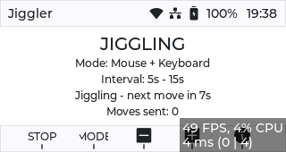

<p align="center">
  <picture>
    <source
      media="(prefers-color-scheme: dark)"
      srcset="./screenshot/jiggler-dark.png"
    />
    <source
      media="(prefers-color-scheme: light)"
      srcset="./screenshot/jiggler-light.png"
    />
  
  </picture>
</p>

<div align="center">
    <h1>Jiggler</h1>
</div>

<div align="center">
  <p>A USB HID activity jiggler for CardputerZero, controlled entirely with the five keys under the screen.</p>
</div>

<p align="center" style="margin: 20px 0; display: flex; justify-content: center; flex-wrap: wrap; gap: 12px;">
  
  
  
  
</p>

<p align="center">
  <a href="https://discord.gg/ysQAWBUE9Q">
    
  </a>
</p>

Built on the [CardputerZero Template](https://github.com/CardputerZero/Template) (LVGL + CMake, SDL desktop
simulator, aarch64 device cross-build). Tested on a real CardputerZero with Windows and macOS hosts - see
[Hardware Status](#hardware-status) below.

## What It Does

CardputerZero's USB-A and USB-C ports are host/slave switchable. When a port is in **Slave/Device** mode,
this app can make the device present itself as a USB mouse and/or keyboard, sending small periodic
movements/pulses so a connected computer sees activity and does not go to sleep or lock - the classic
"mouse jiggler" use case, without any extra dongle.

Everything is keyboard-driven, no touch required:

| Key | Action |
| --- | --- |
| `4` | Start / stop jiggling |
| `5` | Cycle output mode: Mouse (default) -> Keyboard -> Mouse + Keyboard |
| `6` | Decrease the randomized interval window (both bounds, -1s) |
| `7` | Increase the randomized interval window (both bounds, +1s) |
| `8` | Toggle an info panel explaining the current output backend |
| `ESC` / `HOME` (hold) | Exit |

The interval is a randomized window (default 5s-15s) rather than a fixed period, so activity looks less
mechanical. The last-used mode and interval are saved and restored the next time the app opens.
Keyboard mode only taps Left Shift, so nothing is ever typed on the host. The on-screen status line always shows what actually happened on the last jiggle and why, per
the project's "never claim hardware success that didn't happen" rule (see below).

## Hardware Status

- **Desktop simulator (`USE_DESKTOP=ON`)**: jiggling is fully interactive (start/stop, mode, interval, live
  countdown, move counter) but the actual mouse/keyboard output is **simulated only** - nothing is sent
  to the host OS. This is intentional: there is no real USB gadget to drive on a desktop build.
- **Device build (`USE_DESKTOP=OFF`, `src/platform/jiggle_output.cpp`)**: writes standard USB HID
  boot-protocol reports directly to `/dev/hidg0` (keyboard, modifier-only pulse so nothing is actually
  typed) and `/dev/hidg1` (mouse, small relative move). This assumes the OS has already put the port in
  Slave/Device mode and bound a composite HID gadget exposing those nodes - the app itself never runs as
  root; the gadget is created at boot by the packaged `jiggler-hid-gadget.service` (below). If the nodes
  are missing or not writable, the app reports that explicitly instead of pretending the jiggle worked.
- **Tested on a real CardputerZero (2026-11-16)** against Windows and macOS hosts: the mouse jiggle
  moves the host pointer (12-24 px, then back) and the PC enumerates the device as a composite
  keyboard + mouse. Only the **right-side USB port** works as a device port, with the USB switch set
  to **Device**; that port also charges the Cardputer. The app shows this reminder for 6 s at start.
- **Gadget setup** lives in `tools/`: `setup-hid-gadget.sh` creates `/dev/hidg0` (keyboard) and
  `/dev/hidg1` (mouse) through ConfigFS and hands them to the app user; `jiggler-hid-gadget.service` runs
  it at boot. The `.deb` installs both (`/usr/lib/jiggler/`, `/usr/lib/systemd/system/`) and its
  `postinst` enables the service, so nothing has to be set up by hand. The service does not run as root:
  it uses a systemd `DynamicUser` with only `CAP_DAC_OVERRIDE` (ConfigFS is root-owned). The udev rule
  `/usr/lib/udev/rules.d/60-jiggler.rules` gives `/dev/hidg*` to group `plugdev` (mode 0660), which the
  default CardputerZero user belongs to.
- **Screen off while jiggling:** after 30 s without a key press the backlight turns off
  (`/sys/class/backlight/backlight/brightness`, writable by the `video` group). Any key turns it back
  on; that key press is swallowed so it never triggers its action. Brightness is restored on exit.

## Project Overview

Same small MVVM-style structure as the upstream template:

- **UI layer**: `JigglerScreen` (the only screen) is built from LVGL objects under `BaseScreen`, which owns
  the title bar, nav bar, and content area. Widgets derive from `BaseWidgets`.
- **Data model**: `BaseModel` (`src/model`) stores jiggling state - active flag, output mode, interval
  bounds, moves-sent counter - plus theme mode.
- **View model**: `BaseViewModel` exposes that state as LVGL observer subjects and UI actions
  (`toggle_jiggling`, `cycle_jiggler_mode`, `increase_interval`, `decrease_interval`, `toggle_info`,
  `request_quit`). It never touches hardware directly.
- **Reactive/data binding**: `src/reactive` wraps LVGL observer subjects so labels/styles/flags stay in
  sync with application state.
- **`app::JigglerController`** (`src/app`): the piece that actually does something. It observes
  `active_subject()`, runs the randomized timer, and calls `platform::JiggleOutput` to perform each jiggle,
  reporting the outcome back into `status_subject()`. Owned by `Application::run()`, same lifetime pattern
  as `ScreenManager` and the shortcut controller.
- **`platform::JiggleOutput`** (`src/platform/jiggle_output.*`): the hardware boundary described above.
- **Data flow**: key press -> nav bar callback -> `BaseViewModel` action -> subject update -> UI refresh,
  *and separately* subject update -> `JigglerController` -> `platform::JiggleOutput` -> status text back into
  the view model.

## Repository Layout

```text
.
├── assets/                 # Runtime assets used by the app
│   ├── applications/       # Desktop/app launcher metadata
│   ├── audio/              # Audio resources
│   ├── fonts/              # TTF fonts loaded through FreeType
│   └── images/             # Image resources
├── screenshot/             # Screenshots captured on a real CardputerZero
├── src/
│   ├── app/                # Application lifecycle, asset loading, screen management
│   ├── config/             # LVGL config headers for desktop and device builds
│   ├── logger/             # Project logging wrapper
│   ├── model/              # Base application data model
│   ├── platform/           # Platform input/hardware integration
│   ├── reactive/           # LVGL observer subjects and binding helpers
│   ├── view/               # Theme, UI constants, screens, and widgets
│   │   ├── screens/        # Page-level LVGL screens
│   │   └── widgets/        # Reusable LVGL widgets such as nav bar and icon button
│   ├── viewmodel/          # BaseViewModel and UI-facing actions/state subjects
│   └── main.cpp            # Program entry point
├── CMakeLists.txt          # Build graph, dependencies, options, targets
├── CMakePresets.json       # Desktop/device configure and build presets
└── README.md
```

### Modules

- `src/app/asset_manager.*`: resolves runtime assets from the optional CMake asset root, source tree `assets/`, and installed `/usr/share/<APP_NAME>/` path.
- `src/app/screen_namager.cpp`: constructs and loads the single `JigglerScreen` on startup.
- `src/app/jiggler_controller.*`: the randomized jiggle timer; bridges `BaseViewModel` to `platform::JiggleOutput`.
- `src/platform/jiggle_output.*`: desktop-simulated vs. USB HID gadget (`/dev/hidg0`/`/dev/hidg1`) output backends.
- `src/app/desktop_simulator_frame.*`: owns the desktop SDL window, renderer, high-resolution shell textures, input, and LVGL texture composition.
- `src/config/lv_conf_desktop.h`: desktop LVGL rendering settings.
- `src/config/lv_conf_cm0.h`: embedded Linux/CardputerZero LVGL settings.
- `src/platform/linux_input.*`: Linux evdev keypad support and desktop SDL keyboard routing for nav buttons.
- `src/reactive/subjects.*`: typed wrappers around LVGL subjects.
- `src/reactive/bindings.*`: helper bindings for labels, theme, widget values, flags, states, and events.
- `src/view/widgets/navbar.*`: bottom navigation bar and icon-button action mapping.
- `src/view/widgets/icon_button.*`: transparent icon button with font/color/theme support.

## Build Options

Common CMake cache options:

| Option | Default | Description |
| --- | --- | --- |
| `USE_DESKTOP` | `ON` | Build SDL desktop simulator when `ON`; build embedded Linux target when `OFF`. |
| `APP_NAME` | `jiggler_app` | Application name used by installed asset lookup. |
| `APP_ASSETS_ROOT` | empty | Optional runtime asset root. Expected layout includes `fonts/`, `images/`, etc. |
| `APP_CONFIG_FILE` | platform default | Optional config path. Defaults to `config/jiggler-app.conf` for desktop builds and `/etc/jiggler-app.conf` for device builds. |
| `APP_KEY_INPUT_DEVICE` | empty | Optional Linux evdev device path, e.g. `/dev/input/event0`. Empty means auto-scan `/dev/input/event*`. |
| `APP_FRAMEBUFFER_DEVICE` | `/dev/fb0` | Linux framebuffer device used by embedded builds when `APP_USE_DRM=OFF`. |
| `APP_USE_DRM` | `OFF` | Use LVGL's Linux DRM/KMS backend instead of fbdev for embedded builds. |
| `APP_DRM_DEVICE` | `/dev/dri/card0` | DRM device path used when `APP_USE_DRM=ON`. |
| `APP_DRM_CONNECTOR_ID` | `-1` | DRM connector id used when `APP_USE_DRM=ON`; `-1` auto-selects. |

Asset lookup order:

1. `APP_ASSETS_ROOT` when provided by CMake
2. source-tree `assets/` for development
3. `/usr/share/<APP_NAME>/` for installed deployments

Theme startup behavior is configured in `config/jiggler-app.conf`:

```ini
[application]
dark_mode=no
# written by the app when you change them:
mode=mouse          # mouse | keyboard | both
interval_min=5      # window start in seconds; the window keeps its 10 s spread
```

Set `dark_mode` to `yes` or `no`. The parser also accepts `true`/`false` and `1`/`0`. `mode` and
`interval_min` are saved to the per-user file below whenever you change them on the device; invalid
values are ignored and the defaults (mouse, 5s-15s) are used.
Installed device builds use `/etc/jiggler-app.conf` as the system default. Unlike the upstream
template, all five nav bar keys are used for jiggler controls (see [What It Does](#what-it-does)), so
there is currently no in-app key to toggle the theme - edit the config file (or the per-user override
at `$XDG_CONFIG_HOME/jiggler-app/jiggler-app.conf` / `~/.config/jiggler-app/jiggler-app.conf`) and
restart. `BaseViewModel::toggle_dark_mode()` still exists in code for a future settings screen.

## Desktop Builds

Desktop builds are intended for fast UI development. LVGL renders at the device-native `320x170` resolution, while SDL composites that texture into a hardware-accelerated, high-DPI simulator window with the full-resolution device shell.

Current dependencies info:

| Dependency | Version | Source | Notes |
| --- | --- | --- | --- |
| LVGL | `v9.5.0` | `CMakeLists.txt` FetchContent | Main GUI framework. |
| fmt | `12.1.0` | System package manager or `vcpkg.json` override | Logging and formatted strings. |
| libpng | `1.6.48` | System package manager or `vcpkg.json` override | PNG image decoding support for LVGL. |
| libjpeg-turbo | `3.1.3` | System package manager or `vcpkg.json` override | JPEG image decoding support for LVGL. |
| zlib | `1.3.1` | System package manager or `vcpkg.json` override | Compression dependency used by image libraries. |
| SDL2 | `2.32.54` | System package manager or `vcpkg.json` override | Desktop simulator display and input backend. |
| FreeType | `2.13.3` | System package manager or `vcpkg.json` override | Runtime TTF font rendering. |

> Windows vcpkg installs use the versions above through manifest mode, with the registry baseline pinned in `vcpkg-configuration.json`.

### Linux Desktop

Debian/Ubuntu dependencies:

```shell
sudo apt update
sudo apt install -y \
  build-essential \
  cmake \
  ninja-build \
  libpng-dev \
  libjpeg-dev \
  libfmt-dev \
  libsdl2-dev \
  libfreetype-dev \
  zlib1g-dev
```

> [!NOTE]
> Minimal CMake version is 3.31.0 (in coordinate with Debian 13 trixie), for Ubuntu user you can install latest cmake via `snap`
> and run following cmake command with `/snap/bin/cmake`.


Configure:

```shell
cmake --preset linux-x86-64
```

Build:

```shell
cmake --build --preset linux-x86-64-dbg
# alternatively, you can run release build
# cmake --build --preset linux-x86-64-rel
```

Run:

```shell
./build/linux-x86-64/Debug/jiggler_app
# or launch release build
# ./build/linux-x86-64/Release/jiggler_app
```

### macOS Desktop

Install the Apple command-line tools:

```shell
xcode-select --install
```

Install dependencies with Homebrew:

```shell
brew install \
  cmake \
  ninja \
  libpng \
  jpeg \
  fmt \
  sdl2 \
  freetype \
  dpkg \
  zlib
```

Configure for Apple Silicon:

```shell
cmake --preset darwin-arm64
```

Build:

```shell
cmake --build --preset darwin-arm64-dbg
# alternatively, you can run release build
# cmake --build --preset darwin-arm64-rel
```

Run:

```shell
./build/darwin-arm64/Debug/jiggler_app
# or launch release build
# ./build/darwin-arm64/Release/jiggler_app
```

For Intel macOS, use the `darwin-x86-64` configure preset and matching build preset:

```shell
cmake --preset darwin-x86-64
cmake --build --preset darwin-x86-64-dbg
# alternatively, you can run release build
# cmake --build --preset darwin-x86-64-rel
./build/darwin-x86-64/Debug/jiggler_app
# or launch release build
# ./build/darwin-x86-64/Release/jiggler_app
```

### Windows Desktop

Install CMake and Ninja:

```powershell
winget install Kitware.CMake
winget install Ninja-build.Ninja
```

Install a C++ toolchain. Choose one of the following.

MSVC Build Tools:

```powershell
winget install Microsoft.VisualStudio.BuildTools
```

In the Visual Studio installer, enable **Desktop development with C++** and make sure MSVC and a Windows SDK are selected.

MinGW-w64:

```powershell
winget install BrechtSanders.WinLibs.POSIX.UCRT
```
Alternatively, you can download from [`winlibs`](https://winlibs.com/). 

Install vcpkg:

```powershell
git clone https://github.com/microsoft/vcpkg.git C:\vcpkg
C:\vcpkg\bootstrap-vcpkg.bat -disableMetrics
```

Configure environmental variables for current terminal:

```
$env:VCPKG_ROOT="C:\vcpkg"
$env:PATH="$env:VCPKG_ROOT;$env:PATH"
```

> [!TIP]
> Change `VCPKG_ROOT` to your vcpkg installation directory if it is located elsewhere.
>
> These environment variables are **session-scoped**, meaning they only apply to the current terminal session.
> Once the terminal is closed, the variables will be lost and need to be set again in a new session.
> If you want to a persist environment variable
> ```powershell
> setx VCPKG_ROOT "C:\vcpkg"
> ```


Configure and build with MSVC:

> [!IMPORTANT]
> These steps require launching CMake from a **Developer Command Prompt** or **Developer PowerShell** provided by Visual Studio.
>
> This ensures that the MSVC environment (compiler, linker, and Windows SDK paths) is properly initialized.
>
> Without this environment setup, CMake may fail to detect or correctly configure the MSVC toolchain.

```powershell
cmake --preset win32-msvc
cmake --build --preset win32-msvc-dbg
.\build\msvc\Debug\jiggler_app.exe

# alternatively for release build
# cmake --build --preset win32-msvc-rel
# .\build\msvc\Release\jiggler_app.exe
```

Configure and build with MinGW-w64:

> [!IMPORTANT]
> These steps require a properly configured MinGW-w64 toolchain in your system PATH.
>
> Please ensure the following compilers are available in the current terminal session:
> - gcc
> - g++
> - ld
> - ar
>
> You can verify the setup by running:
> ```powershell
> gcc --version
> g++ --version
> ```
>
> If these commands are not recognized, you must add MinGW-w64 `bin` directory to your PATH before configuring CMake.

```powershell
cmake --preset win32-mingw64
cmake --build --preset win32-mingw64-dbg
.\build\mingw64\Debug\jiggler_app.exe

# alternatively for release build
# cmake --build --preset win32-mingw64-rel
#.\build\mingw64\Release\jiggler_app.exe
```
> [!NOTE]
> `VCPKG` will handle the dependencies during CMake configuration process automatically, 
> this may take several minutes depend on you network connection.

## CardputerZero Cross Build

This preset builds an aarch64 Linux target from a host machine with an `aarch64-linux-gnu-gcc/g++` toolchain.
The BSP at `.cache/sdk_bsp-src` is treated as a sysroot: headers, libraries, startup objects, and pkg-config metadata are resolved from that directory first.
If that directory does not exist on the first configure, the toolchain downloads and extracts `sdk_bsp.tar.gz` automatically before CMake runs compiler checks.

Install a cross compile toolchain:

+ Debian

```shell
sudo apt install crossbuild-essential-arm64
```
+ MacOS

```shell
brew install aarch64-unknown-linux-gnu
```

> [!NOTE]
> On Windows, it's recommended to use WSL for cross build
> or you can download [cross compile tools](https://sysprogs.com/getfile/2542/raspberry64-gcc14.2.0.exe) and configure the `PATH` yourself

Configure:

```shell
cmake --preset cp0-cross
```

Build:

```shell
cmake --build --preset cp0-cross-dbg
# or release build
# cmake --build --preset cp0-cross-rel
```

Deploy the release package to your device after filling in your device user and IP:

```shell
REMOTE_USER=<user> REMOTE_HOST=<device-ip> ./deploy.sh
```

By default, the debian package is copied to '$HOME' folder, normally it's under '/home/\<user\>'.

On your device, install the copied package with `apt` and replace the package file name with the one you copied:

```shell
sudo apt install --no-install-recommends ./Jiggler_0.1.0_m5stack1_arm64.deb
```


## Development Guide

### Navigation Keys

The nav bar maps hardware/keyboard keys `4`-`8` to fixed jiggler actions (see
[What It Does](#what-it-does) for the full table). Unlike the upstream template, this bar does not
change per screen - there is only one screen - and `ESC`/`HOME` is a separate dedicated key reserved
for exit (hold ~700ms; a tap only shows a reminder toast). This is deliberately different from the
template default, where key `4` doubled as both a nav action and the exit key: here key `4` is the
frequently-used Start/Stop action, so it stays free for a plain tap and does not arm the exit sequence.
See `ShortcutController::handle_key` in `src/app/app.cpp`.

### Adding a Screen

This app currently has a single screen (`JigglerScreen`) and no page-switching machinery -
`ScreenManager::start()` just constructs and loads it once. To add a second screen (e.g. a settings
page), you would need to reintroduce a page enum/subject along the lines of the upstream template's
`model::AppPage` and extend `ScreenManager`, `HelpPopup`, and the nav bar accordingly.

### Adding a Widget

1. Derive from `BaseWidgets`.
2. Implement `build()` and create LVGL objects under `parent_`.
3. Use `reactive::bind_*` helpers for text, style, state, or event bindings.
4. Keep LVGL observer lifetimes object-bound whenever possible with `lv_subject_add_observer_obj` or `reactive::observe_obj`.

### Fonts and Assets

Device builds use Noto Sans CJK Medium for the default bold text and Noto Sans CJK Regular for regular-weight text. They are loaded through FreeType from:

```text
/usr/share/fonts/opentype/noto/NotoSansCJK-Medium.ttc
/usr/share/fonts/opentype/noto/NotoSansCJK-Regular.ttc
```

When either system font is unavailable, the UI falls back to LVGL's built-in Montserrat fonts. Desktop builds always use the fallback fonts. Runtime icon and other asset fonts remain under:

```text
assets/fonts/
/usr/share/<APP_NAME>/fonts/
```

You can also provide an asset root at configure time:

```shell
cmake --preset darwin-arm64 -DAPP_ASSETS_ROOT=/path/to/assets
```


## Debian Package

Debian packages are produced with CPack and written to `dist/`. The package file name follows:

```text
<AppName>_<Version>_m5stack1_arm64.deb
```

Default example:

```text
dist/Jiggler_0.1.0_m5stack1_arm64.deb
```

Package layout:

| Path | Content |
| --- | --- |
| `/usr/bin/jiggler_app` | Application executable. |
| `/etc/jiggler-app.conf` | System-default application settings, including the startup theme. |
| `/usr/share/jiggler_app/` | Runtime assets: fonts, images, audio. |
| `/usr/share/APPLaunch/applications/jiggler_app.desktop` | APPLaunch launcher entry. |
| `/usr/share/APPLaunch/share/images/jiggler*.png` | APPLaunch launcher icons/fallbacks. |
| `/usr/share/doc/jiggler_app/` | README and third-party asset license notes. |

No systemd service is installed (`APP_INSTALL_SYSTEMD_SERVICE=OFF` in `cmake/cm0-package.cmake`) - this
is a foreground app launched from APPLaunch, matching `background_service: false` in `app-builder.json`.

Build and package:

```shell
cmake --preset cp0-cross
cmake --build --preset cp0-cross-rel
cpack --preset cp0-cross-deb
```

Or run the full configure, release build, and package flow with one workflow preset:

```shell
cmake --workflow --preset cp0-cross-package
```

> [!NOTE]
> Use Debian based Linux host with CPack generator 
> as other OS may not resolve the dependencies correctly
> no full dpkg, dpkg-shlibdeps, objdump and readelf support

# Status

Version 0.1.0 works on real CardputerZero hardware (see [Hardware Status](#hardware-status)): mouse and
keyboard output over the right-side USB port in Device mode, screen-off while jiggling, and the USB gadget
set up automatically by the package at boot.

# License

Project released under MIT license. More license information can be found in assets folder. 
